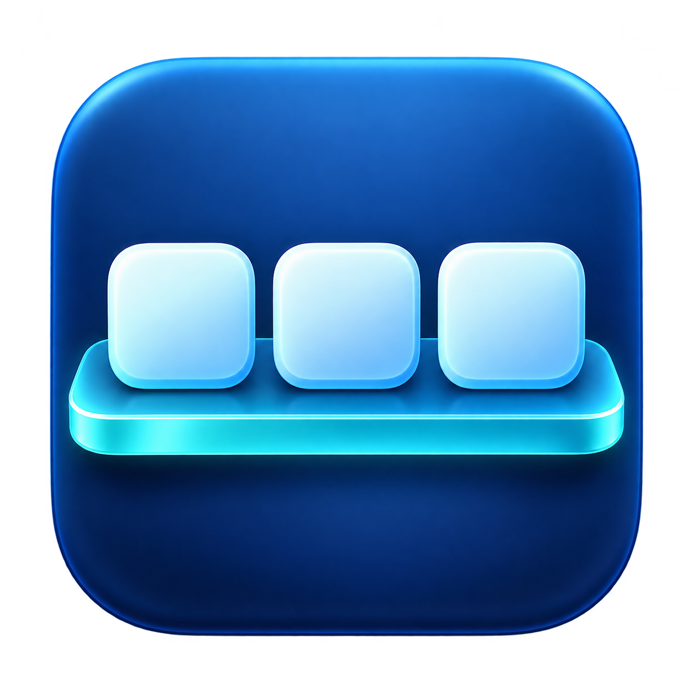
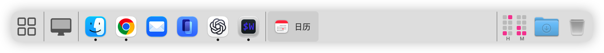
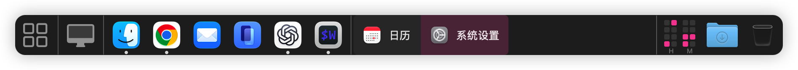

<p align="center">
  
</p>

<h1 align="center">Plank</h1>

An XFCE-inspired panel for macOS, with app shortcuts, running apps, an application menu, clocks, and Trash. Use it alongside the system Dock or enable Dock replacement in settings.

<p align="center">
  
</p>

<p align="center">
  
</p>

Requires **macOS 14 or later**. Plank sits at the bottom of your primary display and supports multiple desktop Spaces.

## Installation

### 1. Homebrew

```sh
brew tap imkerberos/plank https://github.com/imkerberos/Plank.git
brew install --cask imkerberos/plank/plank
```

The Cask installs the universal macOS app in `/Applications`.

### 2. Download the DMG

Download the [latest Plank DMG](https://github.com/imkerberos/Plank/releases/latest/download/Plank-latest-macos-universal.dmg), open it, and drag `Plank.app` to `/Applications`.

Release builds are ad hoc signed and are not notarized. This verification step may be needed for both Homebrew and DMG installations. If macOS blocks Plank after installing it from a source you trust, either launch it once and choose **Open Anyway** in **System Settings → Privacy & Security**, or remove only this app's quarantine attribute:

```sh
xattr -dr com.apple.quarantine /Applications/Plank.app
open /Applications/Plank.app
```

If Homebrew uses a different application directory, replace `/Applications/Plank.app` with the actual path to `Plank.app`.

### 3. Build with Swift

Install Swift 6 or later, then build the executable with Swift Package Manager:

```sh
git clone https://github.com/imkerberos/Plank.git
cd Plank
swift build -c release
swift run Plank
```

To create an installable app bundle from the same Swift build, use the repository's Just task:

```sh
just build-app universal
open dist/Plank.app
```

## Getting Started

1. Copy `Plank.app` to `/Applications` and open it.
2. Right-click the panel's left-hand three-dot handle and choose **Settings…** to adjust its appearance.
3. Choose **Plugins…**, or **Manage Plugins…** in settings, to customize the panel.
4. Enable **Launch at Login** if you want Plank to start when you sign in. If approval is needed, use **Open Login Items Settings…**.

Settings save automatically. To quit, choose **Quit Plank** from the panel menu. Quit normally so Plank can restore the system Dock if it is hidden.

New panels use the following layout:

**iMenu → Separator → Show Desktop → Separator → Launcher → Separator → Taskbar → expanding Space → Separator → Clock (Binary) → Trash**

Existing saved layouts are preserved when you update Plank.

## Panel Settings

Open **Settings…** from the panel menu.

| Setting          | Options                                                                                                  |
| ---------------- | -------------------------------------------------------------------------------------------------------- |
| Theme | Follow System (default), Dark, or Light. Applies immediately to the panel, menus, and settings. |
| Width            | 10%–100% of the screen; defaults to 100%. Full-width panels have square corners.                         |
| Height           | Tiny (32 pt), Small (48 pt), Medium (64 pt), Large (80 pt), or Custom (32–128 pt). Defaults to Medium.   |
| Launch at Login  | Start Plank automatically when you sign in. Install the app in its permanent location first.             |
| Hide System Dock | Hide the system Dock and keep supported maximized windows clear of Plank. Requires Accessibility access. |

Press Return to apply a custom height. Switching height presets preserves your last custom value. If the panel's contents exceed its width, scroll horizontally to reach them.

### Replacing the System Dock

**Hide System Dock** is off by default. Until you enable it, Plank sits above the system Dock's reserved area.

To use Plank as your Dock replacement:

1. In panel settings, choose **Open Accessibility Settings…** and allow Plank. Permission names can vary by macOS version.
2. Return to Plank and enable **Hide System Dock**.

Plank then sits at the physical bottom edge and adjusts supported maximized or full-height tiled windows to leave room for it. This clearance spans the bottom edge even when the panel is narrower than the screen. Smaller floating windows are left alone. Plank hides while native full-screen apps are active in Dock replacement mode.

Turning this option off or quitting normally restores your previous Dock settings. After an unexpected exit, reopen Plank so it can recover the Dock settings.

Some apps enforce their own window sizes. Window managers such as Hammerspoon may need their own Plank-aware configuration; see the [window-space notes](docs/DEVELOP.md#dock-replacement-and-window-space).

### Locking the Panel

Choose **Lock Panel** in the panel menu to hide handles and prevent dragging plugins or Launcher shortcuts directly on the panel. Right-click an empty panel area to unlock it.

You can still open apps, use their context menus, and **reorder or configure plugins in the Plugins window while locked**.

## Managing Plugins

Open **Plugins…** from the panel menu or **Manage Plugins…** from settings.

- **Add…** lists all available plugin types. You can add multiple instances, each with its own settings.
- Drag a row to reorder it, even while the panel is locked. A horizontal line marks the insertion position. Press Esc or release outside the list to cancel.
- Double-click a row to open its settings and change its name or options.
- Select a row and choose **Remove** to remove that plugin.
- To hide a plugin, use its panel context menu. Hidden plugins remain in the list; right-click a hidden row and choose **Show Plugin** to restore it.

When unlocked, each plugin except Separator has a vertical three-dot handle. Click or right-click the handle for its menu. Right-click Separator directly. Choose **Move** to drag a plugin along the panel; release outside the panel or choose **Cancel Move** to cancel.

### iMenu

Click the four-square icon to browse applications. Type to search, click a result to launch it, or use arrow keys and Return. Press Esc or click outside to close.

In iMenu settings, choose **List View** or **Icon View**. Icon View displays larger icons and app names in a grid that adapts to the menu width. Drag the menu's edges or corners to resize it; each iMenu remembers its size. The menu aligns with its button and stays next to the panel.

The bottom row provides **Lock**, **Sleep**, **Restart…**, and **Shut Down…**. Restart and Shut Down ask for confirmation. These actions may require Automation permission for System Events; Lock also requires Accessibility access.

### Launcher

Drag apps from Finder, or app buttons from Taskbar, onto Launcher to add shortcuts. Click a shortcut to open or activate its app. Clicking the current app minimizes its focused window when possible; click again to ask the app to restore a window. Minimizing requires Accessibility access and works with or without the running indicator. The button briefly highlights to confirm the click.

- Drag shortcuts within Launcher to reorder them; an insertion marker shows the destination.
- Drag a shortcut outside the panel, or choose **Remove Shortcut** from its context menu, to remove it. This does not delete or quit the app.
- Release elsewhere on the panel, outside Launcher, to cancel a reorder.
- Locking the panel disables shortcut dragging while keeping app launching available.
- Duplicate shortcuts are ignored within a Launcher. Each Launcher keeps its own list.
- If you move or delete an app, remove its old shortcut and add it again. Ordinary file drops are not supported.

Enable **Show running app indicator** to display a dot below running apps. This also adds app actions to the shortcut's context menu: **Show Windows**, **Hide/Unhide**, **Show in Finder**, and **Quit**. Finder does not offer Quit. Apps that are not running offer **Open** instead. Restoring minimized windows through Show Windows requires Accessibility access.

### Taskbar

Taskbar displays running apps and highlights the active app.

- Click an app to bring it forward. If it has no windows, Plank asks it to reopen; the app decides whether to create a window.
- Click the active app to minimize its focused window. Click again to ask the app to restore a window. Minimizing requires Accessibility access.
- Right-click an app button for **Show**, **Hide/Unhide**, **Show in Finder**, and **Quit**. Finder does not offer Quit. Right-click the handle for plugin settings.
- Drag an app button into Launcher to add a shortcut. Dropping it outside the panel has no effect.

Finder appears first unless **Hide Finder** is enabled. Other apps follow window opening order as observed by Plank. When the order is unknown, such as windows already open when Plank starts, Plank falls back to app-name sorting. Switching apps does not change the order; apps without windows appear after those with windows.

Taskbar settings include:

| Setting               | Effect                                                             |
| --------------------- | ------------------------------------------------------------------ |
| Style                 | Icons Only, or Icons and Titles with the app name beside its icon. |
| Maximum width         | Limit labeled buttons to 80–400 pt; defaults to 180 pt.            |
| Hide Finder           | Remove Finder from this Taskbar.                                   |
| Hide apps in Launcher | Hide apps with shortcuts in any enabled Launcher on the panel.     |

### App Badges

Launcher and Taskbar show available system Dock badges in the icon's upper-left corner. Counts over 99 appear as **99+**; long text labels appear as a red dot.

Badges require Accessibility access. Only badges supplied by the system Dock can be shown; some apps provide no readable badge, and an existing badge may not be available immediately after startup or a Dock restart. Plank cannot independently calculate Mail or WeChat unread counts.

### Folder

Add **Folder** from the Plugins window. Double-click its row, choose **Choose Folder…**, and select a directory. Click the panel icon to open that directory in Finder. Each instance has its own location and defaults to your home folder. If a folder is moved, deleted, or on a disconnected drive, choose its new location in the plugin settings.

### Separator

Choose **Line** for a thin vertical divider spanning the panel height, or **Space** for a blank area of 8–400 pt. Enable **Expand to fill remaining panel space** to use the available space. Multiple expanding separators share that space equally.

### Clock

Choose **Digital**, **Analog**, or **Binary** in Clock settings. Digital and Binary support **Use 24-Hour Time**; all styles support **Show Seconds**. Hover over the clock for the date and readable time.

Enable **Open Calendar on Click** in Clock settings to open the system Calendar app by clicking the clock. This works with every clock style, including while the panel is locked. It defaults to off and is saved independently for each Clock.

Binary clock columns represent decimal digits. Read the lit dots from top to bottom as **8, 4, 2, 1**, and add them to obtain each digit. The groups are hours, minutes, and optional seconds. New panels use Binary; existing clocks keep their saved style.

### Show Desktop

Click the monitor icon to move windows aside and reveal the desktop. Click again to restore them. The panel stays visible, including when locked. No Hammerspoon setup is needed.

This feature depends on an internal macOS capability and may need an update after a macOS upgrade.

### Trash

Click Trash to open it in Finder. Its icon changes between empty and full, with status checks approximately every two seconds. Reading the status requires Automation permission for Finder. If status is unavailable, Plank keeps the last known icon; before the first successful check, it shows the default empty icon.

Right-click for **Open Trash** or **Empty Trash…**, including while the panel is locked. Empty Trash asks for confirmation and requires Finder automation permission. **Emptying Trash permanently deletes its contents.**

## Permissions

Grant permissions in **System Settings → Privacy & Security** when you use the corresponding features.

| Permission                 | Used for                                                                                                                                                      |
| -------------------------- | ------------------------------------------------------------------------------------------------------------------------------------------------------------- |
| Accessibility              | Keeping supported windows clear of Plank, minimizing Taskbar windows, restoring minimized windows from Launcher, reading Dock badges, and locking the screen. |
| Automation → Finder        | Reading Trash status and emptying Trash after confirmation.                                                                                                   |
| Automation → System Events | iMenu's Lock, Sleep, Restart, and Shut Down actions.                                                                                                          |

Opening apps and managing shortcuts do not need these permissions. If macOS stops recognizing permissions after an app update, review Plank's entry in System Settings.

## Troubleshooting

**The system Dock stayed hidden after a crash:** Reopen Plank, then turn off Hide System Dock or quit using **Quit Plank**.

**An app overlaps the panel:** Check Accessibility permission and Hide System Dock. Apps with custom sizing rules or external window managers may need separate configuration. Plank does not create a system-wide reserved area that every app can detect.

**An app badge is missing:** Check Accessibility permission. The system Dock must expose the badge; refreshing an app's icon cache does not restore unread counts.

**Trash does not change icons:** Allow Plank to control Finder in Automation settings. A failed status check keeps the previous icon.

## Current Limits

Plank currently uses the primary display's bottom edge. Panel auto-hide, configurable screen-edge positioning, and separate panels on multiple displays are not available. External plugins and dropping files onto Trash are not supported.

For building, architecture, configuration storage, and checks, see [Developing Plank](docs/DEVELOP.md).
